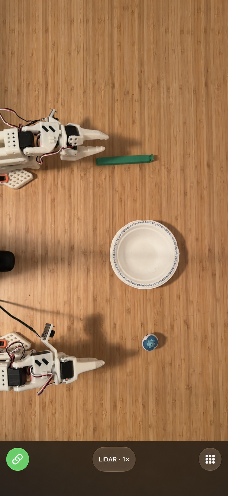
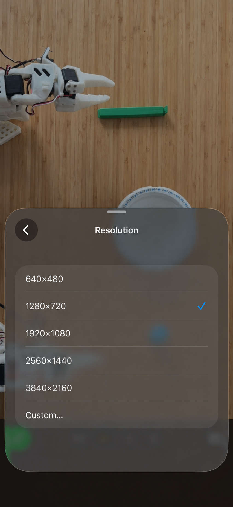
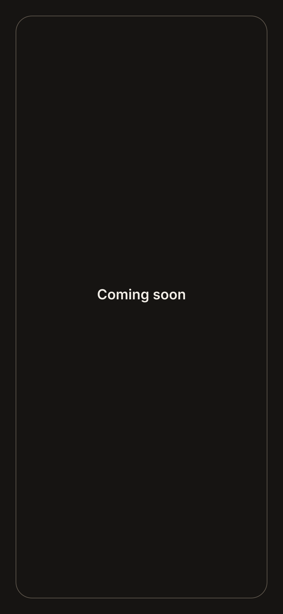

<h1> Rocam</h1>

Turn your iPhone into a USB webcam with optional LiDAR depth.

Built with robotics in mind for overhead views, robot observations, and
synchronized RGB/depth capture.

## App screenshots

<table>
  <tr>
    <td width="33.33%" align="center">
      <br />
      <sub>Camera view</sub>
    </td>
    <td width="33.33%" align="center">
      <br />
      <sub>Resolution settings</sub>
    </td>
    <td width="33.33%" align="center">
      <br />
      <sub>Coming soon</sub>
    </td>
  </tr>
</table>

LiDAR is a sensor that helps the phone see how far things are from it. Your
iPhone may show this as a depth view when it has LiDAR.

## iPhone compatibility

Rocam requires iOS 17 or later. LiDAR depth requires an [iPhone 12 Pro or
iPhone 12 Pro Max](https://support.apple.com/en-us/111875), or a newer Pro
model. RGB-only video also works on supported non-Pro iPhones.

## Set it up with an AI agent

Give this prompt to a coding agent with access to your computer, such as Codex
or Claude Code:

```text
Set up Rocam from https://github.com/ryanjin333/rocam so I can use my
iPhone as a USB webcam on this computer.

Clone the repository if needed, then read README.md, desktop/README.md,
and the setup script for my operating system. Check what is already installed
and use the existing setup scripts rather than creating a separate installer:
- macOS: bash desktop/setup_macos.sh (requires Homebrew)
- Ubuntu/Debian Linux: python3 desktop/setup_linux.py
- Windows PowerShell: ./desktop/setup_windows.ps1 (requires winget)
Run setup from the repository root as the desktop user, not as root.
Install missing prerequisites and configure the receiver to start at login.
Keep USB mode at 30 FPS and microphone forwarding off.

The iPhone app must be installed using Xcode on a Mac, even if the receiver
computer runs Linux or Windows. If a Mac and iPhone are available, help me
open Rocam.xcodeproj, select my Apple Team and real iPhone, and build and run
the app. Otherwise, explain exactly what I need to do on a Mac.
Ask me to handle Apple sign-in, signing choices, device trust, Developer Mode,
and any OS permission or driver approval that requires my interaction.
On macOS, guide me through enabling the OBS Camera Extension and starting
then stopping OBS Virtual Camera once. On Windows, complete the normal OBS
Virtual Camera setup. Preserve unrelated camera and startup configurations.

Verify the receiver is running and configured to start at login. With the
iPhone connected by USB, unlocked, trusted, and running Rocam, verify live
video in a camera app: select Rocam on Linux or OBS Virtual Camera on macOS
and Windows. Keep session keys private. Report what you verified and any
remaining manual steps; do not claim the camera works without a live check.
```

The agent can install and configure the desktop receiver, but you still need
to connect the phone and complete Apple and operating-system approval prompts.
The Linux setup script supports Ubuntu and Debian.

## Setup

You do these two setup steps once.

1. **Set up the iPhone on a Mac.** Open `Rocam.xcodeproj` in Xcode. Choose your Apple
   Team, select your real iPhone, and press **Run**. Open the app on the phone.

2. **Set up the computer.** [Download the current source ZIP](https://github.com/ryanjin333/rocam/archive/refs/heads/main.zip)
   and extract the full repository. Then run the command for your computer:

   - Linux: `python3 desktop/setup_linux.py`
   - macOS: `bash desktop/setup_macos.sh`
   - Windows PowerShell: `./desktop/setup_windows.ps1`

   A macOS release can also use `bash setup_macos.sh` when the script and
   release wheel are next to each other. An unpacked Windows release can use
   `./setup_windows.ps1`.

The setup installs the basic virtual-camera pieces. macOS and Windows use OBS;
Linux uses its virtual-camera driver. Your operating system may ask you to
approve normal camera, driver, or security prompts. macOS setup requires
Homebrew.

## Use it

1. Connect the iPhone to the computer with a USB cable.
2. Unlock the iPhone and tap **Trust** if the iPhone asks.
3. Keep the Rocam app open.

The computer connects by itself and sends video at 30 frames per second. There
is no **Start stream** button. In your video app, choose **Rocam** on Linux, or
**OBS Virtual Camera** on macOS and Windows.

The microphone is off by default. Rocam uses USB for this connection.

For tabletop work, 30 FPS is the default on the phone and desktop receiver. To
use 60 FPS, choose 60 for the phone's capture FPS and live FPS, then start the
desktop receiver at `--fps 60`. Saved live choices, including 20 FPS, are
preserved, so existing users who want 30 FPS need to select it in the phone's
live FPS control. Depth hardware or the selected camera mode can still deliver
fewer frames than the requested rate.

## More information

See the [desktop guide](desktop/README.md) for computer details and the
[feature matrix](FEATURE_MATRIX.md) for platform details.
