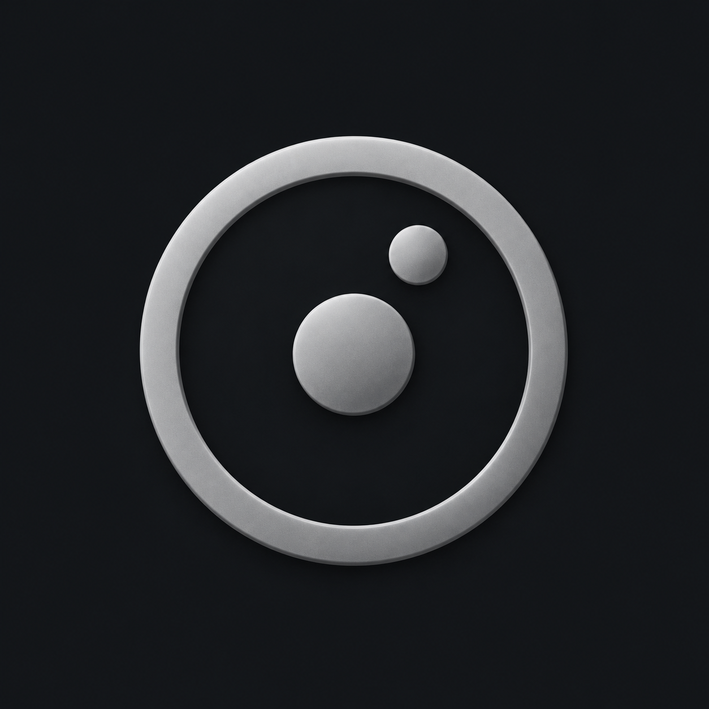
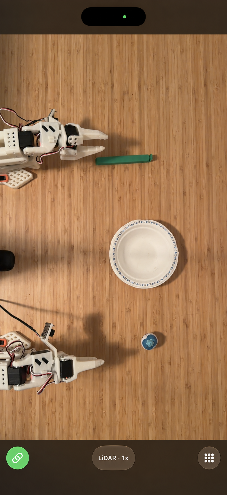
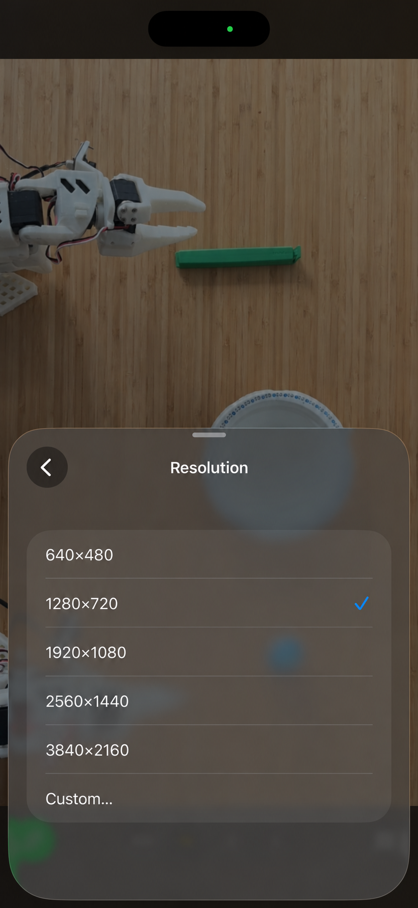
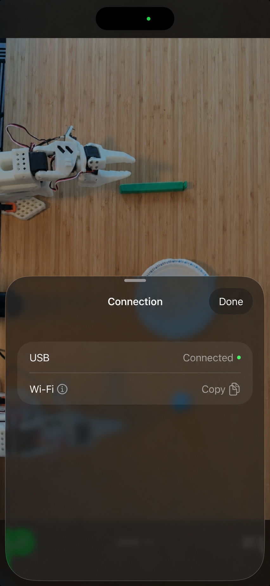

<h1> Rocam</h1>

Turn your iPhone into a USB webcam with optional LiDAR depth.

Built with robotics in mind for overhead views, robot observations, and
synchronized RGB/depth capture.

A minimalist interface keeps the camera view clear, with resolution, FPS,
and LiDAR controls tucked into simple settings.

## App screenshots

<table>
  <tr>
    <td width="33.33%" align="center">
      <br />
      <sub>Camera view</sub>
    </td>
    <td width="33.33%" align="center">
      <br />
      <sub>Resolution settings</sub>
    </td>
    <td width="33.33%" align="center">
      <br />
      <sub>Connection settings</sub>
    </td>
  </tr>
</table>

LiDAR is a sensor that helps the phone see how far things are from it. Your
iPhone may show this as a depth view when it has LiDAR.

## iPhone compatibility

Rocam requires iOS 17 or later. LiDAR depth requires an [iPhone 12 Pro or
iPhone 12 Pro Max](https://support.apple.com/en-us/111875), or a newer Pro
model. RGB-only video also works on supported non-Pro iPhones.

## Computer platforms

- macOS
- Linux (Ubuntu and Debian)

## Set it up with an AI agent

Paste this into Codex or Claude Code:

```text
Set up https://github.com/ryanjin333/rocam as my iPhone USB webcam and verify live video.
```

The agent can install and configure the desktop receiver, but you still need
to connect the phone and complete Apple and operating-system approval prompts.
The Linux setup script supports Ubuntu and Debian.

## Setup

You do these two setup steps once.

1. **Set up the iPhone on a Mac.** Open `Rocam.xcodeproj` in Xcode. Choose your Apple
   Team, select your real iPhone, and press **Run**. Open the app on the phone.

2. **Set up the computer.** [Download the current source ZIP](https://github.com/ryanjin333/rocam/archive/refs/heads/main.zip)
   and extract the full repository. Then run the command for your computer:

   - Linux: `python3 desktop/setup_linux.py`
   - macOS: `bash desktop/setup_macos.sh`
   - Windows PowerShell: `./desktop/setup_windows.ps1`

   A macOS release can also use `bash setup_macos.sh` when the script and
   release wheel are next to each other. An unpacked Windows release can use
   `./setup_windows.ps1`.

The setup installs the basic virtual-camera pieces. macOS and Windows use OBS;
Linux uses its virtual-camera driver. Your operating system may ask you to
approve normal camera, driver, or security prompts. macOS setup requires
Homebrew.

## Use it

1. Connect the iPhone to the computer with a USB cable.
2. Unlock the iPhone and tap **Trust** if the iPhone asks.
3. Keep the Rocam app open.

The computer connects by itself and sends video at 30 frames per second. There
is no **Start stream** button. In your video app, choose **Rocam** on Linux, or
**OBS Virtual Camera** on macOS and Windows.

The microphone is off by default. Rocam uses USB for this connection.

For tabletop work, 30 FPS is the default on the phone and desktop receiver.
In Rocam **Settings → FPS**, choose from 15, 20, 30, 60, or 120 FPS. To use
60 FPS, choose 60 in Settings, then start the desktop receiver at `--fps 60`.
Your choice, including 20 FPS, is saved. The active camera mode and hardware
can limit the available choices; higher FPS may require turning LiDAR off.

## More information

See the [desktop guide](desktop/README.md) for computer details and the
[feature matrix](FEATURE_MATRIX.md) for platform details.

## License

Released under the [MIT License](LICENSE).
